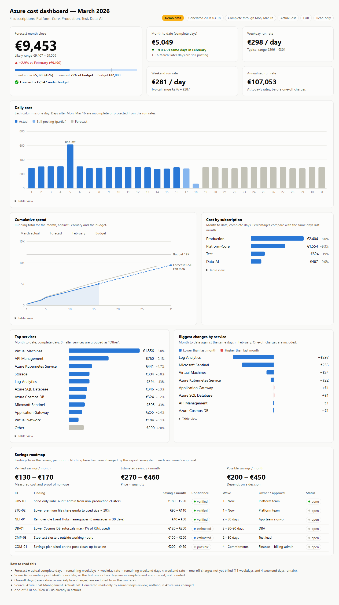

# Azure FinOps Review — read-only skill for AI agents

An [Agent Skill](https://agentskills.io) that lets an AI agent (Claude Code, or any agent that can run shell commands) do a real Azure FinOps review:

- **Explain a cost increase:** subscription → service → resource → meter, down to the change that caused it and who made it.
- **Find savings with evidence:** each item is marked *verified*, *estimated* or *possible*, with usage metrics and a risk/owner note.
- **Build a savings roadmap:** in waves, with no double counting and with guardrails on what not to cut.
- **Check that savings show up in billing:** compare before and after, net of costs that only moved elsewhere.
- **Forecast the month close:** weekday and weekend run rates, late meters, one-off reservation charges, and a range around the figure.

- **Produce a dashboard:** one self-contained HTML file with the forecast, budget, daily and cumulative cost, cost by subscription and service, biggest changes and the savings roadmap.



*Demo data. Generate it yourself with `python scripts/finops_dashboard.py --demo`.*

It uses Azure Cost Management, Resource Graph, Log Analytics and Azure Monitor through the Azure CLI.

## Read-only by design

The skill **never changes anything in Azure**. This is enforced in four layers, from strongest to weakest:

| Layer | What it does | Where |
|---|---|---|
| 1. **Your identity's roles** | Run the review as a user or service principal that only has **Reader**, **Cost Management Reader** and **Log Analytics Reader**. Azure then refuses every write, whatever the agent tries. *This is the only real guarantee.* | Azure RBAC (your side) |
| 2. **Claude Code hook** | A `PreToolUse` hook checks every shell command before it runs. It blocks Azure CLI write verbs, `az account set`, `az rest` PUT/PATCH/DELETE (and POST except the Cost Management query), Az PowerShell `New-/Set-/Remove-/Start-/Stop-…`, `terraform apply/destroy/import/state rm`, `kubectl apply/delete/scale` and `helm install/uninstall`. A blocked command comes back with an instruction not to work around it. | `hooks/readonly_guard.py` |
| 3. **Script guard** | The bundled cost script (and the dashboard script, which reuses it) can only call `az account list`, `az account get-access-token` and `POST …/Microsoft.CostManagement/query`. Anything else is refused in code. | `scripts/finops_cost.py`, `scripts/finops_dashboard.py` |
| 4. **Instructions** | The skill's first section, *Read-only, always*, lists the allowed and forbidden commands. Every change becomes a **recommendation** that a human approves and carries out. | `SKILL.md` |

Limits of layer 2: the hook reads the command text. A write hidden inside another script, or built from variables at run time, can get past it. It is a safety net, which is why layer 1 matters. The hook does not inspect MCP tools: if you also give the agent an Azure MCP server, configure that server read-only too.

## Install

### Claude Code: plugin (recommended; the hook is active for the whole session)

```
/plugin marketplace add Mika765/azure-finops-review
/plugin install azure-finops-review@azure-finops
```

### Claude Code: standalone skill

Copy `plugins/azure-finops-review/skills/azure-finops-review/` to `~/.claude/skills/` (all projects) or `<project>/.claude/skills/` (one project). Its read-only hook is declared in the skill's frontmatter. It becomes active the first time the skill is used in a session and stays active until the session ends. The hook looks for the guard script in those two locations. If the script is missing, it blocks every Azure/IaC command (fail closed).

Hooks run under a POSIX shell. On Windows, Claude Code uses Git Bash for them.

### Other agents (Codex, Copilot, Cursor, …)

Copy the same folder wherever your agent loads skills from. The instructions (layer 4) and the script guard (layer 3) work anywhere. The hook (layer 2) is specific to Claude Code, so **rely on read-only roles (layer 1)**.

## Requirements

- Azure CLI, logged in (`az login`), with the `resource-graph` and `log-analytics` extensions.
- Python 3.9+ (standard library only).
- Roles on the scope under review: Reader, Cost Management Reader, Log Analytics Reader. Reading reservation details and prices at billing-account level needs billing-account roles; the skill reports what it could not see.

## Try it

Ask your agent things like:

- "Why did our Azure bill go up in October?"
- "At what number will we close this month?"
- "Find savings in subscription X and give me a roadmap."
- "Did the changes we made last week actually reduce cost?"

The cost script also runs on its own:

```bash
python scripts/finops_cost.py --tenant <tenantId> --forecast 2026-11 --rate-days 10 --one-off 500@1
python scripts/finops_cost.py --tenant <tenantId> --group ServiceName --before 2026-10-01:2026-10-07 --after 2026-10-15:2026-10-21
python scripts/finops_cost.py --help

# Dashboard: one HTML file, no server, works offline
python scripts/finops_dashboard.py --tenant <tenantId> --budget 20000 --out dashboard.html
python scripts/finops_dashboard.py --demo --out demo.html   # synthetic data, no Azure access
```

The dashboard has light and dark mode, hover details and a table view under every chart, and it prints cleanly. It contains your cost data, so share it like any other internal report.

## Repository layout

```
.claude-plugin/marketplace.json
plugins/azure-finops-review/
  .claude-plugin/plugin.json
  hooks/hooks.json                       # plugin-level read-only hook
  skills/azure-finops-review/
    SKILL.md                             # workflow + read-only rules (+ skill-level hook)
    hooks/readonly_guard.py              # the guard
    scripts/finops_cost.py               # Cost Management queries, forecast, comparisons
    scripts/finops_dashboard.py          # self-contained HTML dashboard
    assets/dashboard_template.html       # dashboard layout (inline CSS/JS, no dependencies)
    references/checks.md                 # savings checks by category
    references/queries.md                # KQL, Resource Graph, Activity Log, budgets
    references/report-template.md
tests/                                   # python tests/test_readonly_guard.py, python tests/test_dashboard.py
docs/dashboard-demo.png
```

## Contributing

If the guard blocks a read command or lets a write command through, add it to `tests/test_readonly_guard.py` and open a PR. Keep the default *deny unless known to be read-only*.

## License

MIT. See `LICENSE`. Not affiliated with Microsoft. Cost figures are estimates; verify against your invoice.
